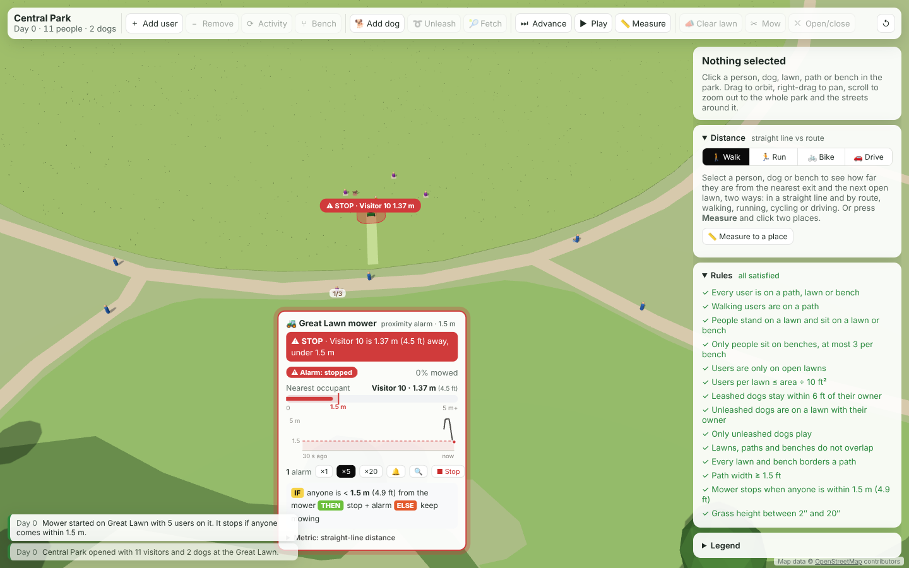
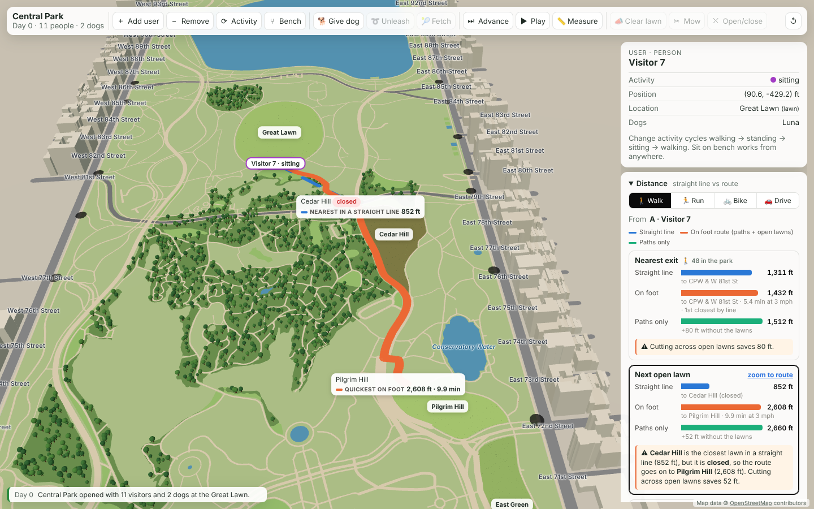
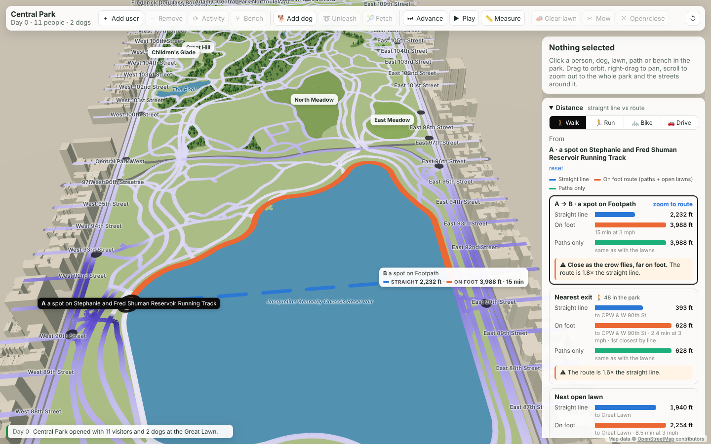
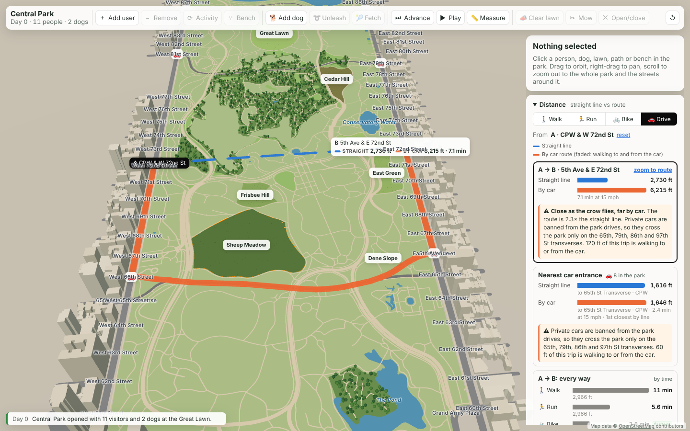
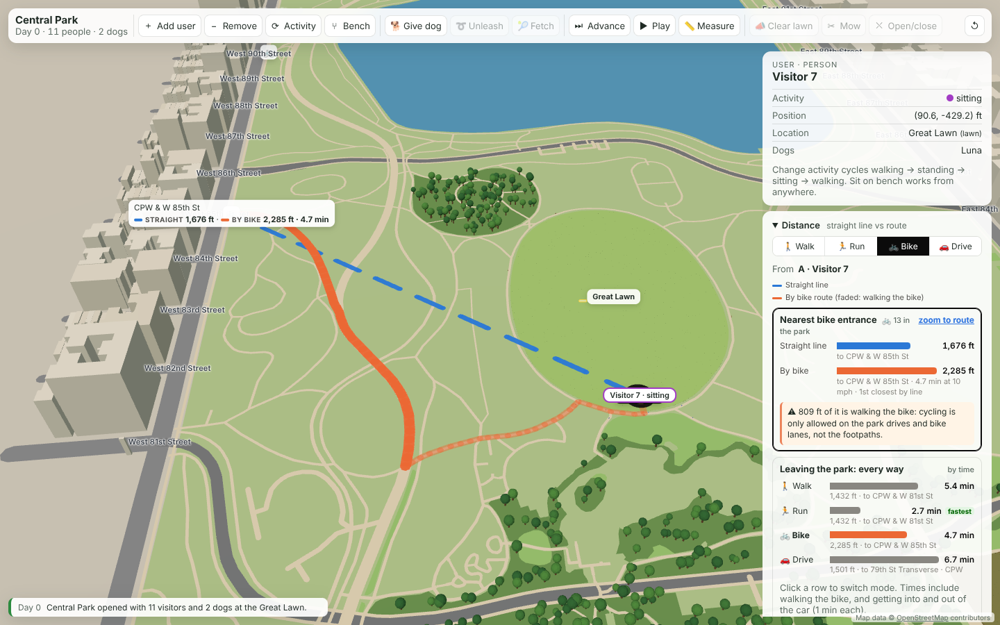

# Environment Simulation: Central Park

A single-page web app, written in vanilla JavaScript with three.js, that visualizes a semantic model of a park. The model has lawns, paths, benches and users (people and dogs), the relationships between them, and the rules they must follow.

## Run

The app uses ES modules, so serve the folder over HTTP instead of opening the file directly:

```sh
npx http-server -c-1 .     # or: python3 -m http.server
```

Then open http://localhost:8080 (or :8000). three.js is loaded from the jsDelivr CDN.

## Map

The park is the real Central Park. `data/central-park.geojson` is a vendored extract of OpenStreetMap: the park outline, 11 named lawns (Sheep Meadow, Great Lawn, East Meadow, North Meadow, Cedar Hill and others), every footpath (split at junctions so walkers follow the real network), water, woods, and the streets and buildings about one block around the park. The app never calls a map API. To refresh the extract, run `python3 scripts/build_central_park.py` (needs `shapely`). Lawns are the OSM outlines with the paths that cross them cut out. The map is drawn in feet, rotated so the Manhattan grid is square to the screen. Map data © OpenStreetMap contributors, ODbL.

## Files

| File | Role |
| --- | --- |
| `js/map.js` | Loads the GeoJSON extract and projects it to feet. |
| `js/model.js` | The semantic model: entities, relationships, rules, actions. Has no rendering code. |
| `js/distance.js` | The two distance metrics for four travel modes: the path, lawn and street network, entrances per mode, Dijkstra. Has no rendering code. |
| `js/mower.js` | The Great Lawn mower: stripe route, the 1.5 m proximity rule, stopping, steering around people. Has no rendering code. |
| `js/mower-ui.js` | The mower's info card on the map, and the alarm sound. |
| `js/distance-ui.js` | The Distance panel: mode picker, bars, every-mode comparison, scatter, near/far list, map overlay, Measure tool. |
| `js/geometry.js` | Polygon helpers: area, containment, overlap, shared edges. |
| `js/view.js` | three.js scene: lawns, paths, users, fences, labels, animation. |
| `js/main.js` | Toolbar, selection, inspector, rule checklist, event log. |

## Model

- **Lawn**: grass height (2–20″), boundary polygon, area (from the boundary), status (open/closed).
- **Path**: width (ft) and boundary polygon. The boundary is swept from a centerline.
- **Bench**: 3 seats, standing just off a path and facing it.
- **User**: a person or a dog. Position (x, y), activity (walking/standing/sitting, plus playing for dogs), location (a path, lawn or bench). A dog has an owner and is on or off its leash.

Relationships are derived from geometry. A path *borders* a lawn, and *connects to* another path, when their boundaries share an edge segment.

The **Rules** panel checks every rule after each action. Actions enforce the rules:

- Users can enter a lawn only if it is open and holds fewer than ⌊area ÷ 10 ft²⌋ users. Dogs count as users.
- People stand on lawns and sit on lawns or benches. Only people sit on benches, at most 3 per bench.
- A leashed dog stays within 6 ft of its owner and does what they do. An unleashed dog must be on a lawn with its owner. Only unleashed dogs play.
- A walking user who changes activity steps onto the nearest bordering lawn that allows it, and stands. A sitting user who changes activity moves to the nearest path and walks.
- Sit on bench moves a person to the nearest bench with a free seat. Their dogs lie on the path at their feet.
- Add dog gives the selected person a leashed dog, or brings a new visitor with a dog. Unleash works only when the owner is on a lawn. Fetch has the owner throw a ball for an unleashed dog.
- **Great Lawn mower (proximity rule).** Mowing the Great Lawn starts a ride-on mower that drives back and forth in 5 ft stripes. **IF** a person or dog is less than **1.5 m (4.9 ft)** from the mower, **THEN** the mower stops and sounds the alarm, **ELSE** it keeps mowing. If someone stays in the zone, the mower waits 2 s, then steers around them on a detour that keeps everyone outside the zone, and leaves that patch unmowed. Other lawns are mowed at once (to 5″), but only when empty; Clear lawn sends everyone on a lawn to the nearest path.
- Closing a lawn moves its users to the nearest path, where they walk.
- Advancing time moves walkers along the path network (turning at junctions) and grows grass, up to 20″.

## Proximity: the Great Lawn mower

Proximity is nearness in space, time or relationship. This simulation tests one kind of "too close": a person or dog near a moving mower.

**Rule.** **IF** a person or dog is less than **1.5 m (4.9 ft)** from the mower, **THEN** the mower stops and sounds the alarm, **ELSE** it keeps mowing.

**Metric.** Straight-line (Euclidean) distance from the mower's body (a 6 × 4.5 ft rectangle) to the occupant's position. Straight line, not route distance, is the right metric here: the blade is the danger, so a path or a fence line between them doesn't make anyone safer.

**How it behaves.**

- The mower drives back and forth over the Great Lawn in 5 ft stripes at about 2.7 mph, shown at ×1, ×5 or ×20 speed. It starts on the stripe nearest the visitors.
- It checks distance every half foot it moves.
- When it stops, it waits until the zone is clear here and a little way ahead, then resumes.
- If someone stays in the zone, it waits 2 s, then plans a detour that keeps everyone outside the zone, trying both sides of the person. That patch is left unmowed.
- The rule holds while it steers too: anyone else who comes close, or the person it is passing getting closer, stops it again.

**What you see.** All of it is on the map at the Great Lawn:

- The mower carries a 1.5 m safety zone. It is green normally, and flashes red with a beacon when someone is inside it.
- A dashed line runs to whoever is within twice the zone.
- Mowed stripes show as lighter grass.
- An info card at the south end of the lawn shows:
  - the mower's status and how much has been mowed;
  - the nearest occupant's distance on a bar against the 1.5 m threshold;
  - a 30-second trace of that distance;
  - the alarm count, speed and sound controls;
  - the rule in IF-THEN-ELSE form.

Alarms also go to the event log, and the Rules panel checks that the moving mower never has anyone inside the zone.

**Try it.** Press **Start mowing** on the card, or select the Great Lawn and press **Mow** (`M`). The mower stops within seconds for the visitors sitting by Turtle Pond. To walk someone into it, select a walker on a path next to the lawn and press **Activity**: they step onto the lawn.



## Distance

Two forms of distance (metrics) between any two places in the park, and so, by where they stand, between any two occupants:

- **Straight line**: Euclidean distance, as the crow flies. It ignores water, woods, fences, buildings and traffic rules.
- **By route**: the length (and time) of the fastest trip over the real network for the chosen travel mode. It is computed with Dijkstra's algorithm on travel time, so it follows complex paths, not just a line of sight (the bonus).

### Travel modes and their entrances

| Mode | Where it can go | Speed | Entrances |
| --- | --- | --- | --- |
| 🚶 Walk | Any footpath, straight across **open** lawns (closed lawns are fenced, so it goes around), and the sidewalks around the park | 3 mph | 48 gates where a footpath crosses the park outline |
| 🏃 Run | Same network as walking | 6 mph | Same 48 gates |
| 🚲 Bike | Rides only on the park drives, their approach roads, bike lanes and the streets. Anywhere else the rider walks the bike. No bikes on the lawns. | 10 mph riding, 3 mph walking the bike | 13 bike entrances where a rideable drive meets the street |
| 🚗 Drive | Private cars are banned from the park drives, so cars cross the park only on the four sunken transverses (65th, 79th, 86th, 97th St) and use the streets around it. From inside the park you walk to the curb, get in, drive, park and walk on. | 15 mph, plus 1 min to get in and 1 min to get out | 8 car entrances at the ends of the transverses |

For walking and running, **paths only** (the same trip without lawn shortcuts) is shown as a reference, so you can see what the open lawns save.

The network is built once from the map:

- Every path vertex is a node, with extra nodes every 40 ft on long segments.
- Each lawn adds straight edges between the path points around its edge, tagged with the lawn so they switch off when it closes.
- The street and transverse lines are split where they cross and snapped together into a road network.
- Each footpath gate is joined to the nearest sidewalk.

That makes about 15,000 nodes. Every edge records who may use it: walkers, riders or cars. Gates are named after the cross street they line up with, for example *CPW & W 81st St*. A query for all four modes takes a few tens of milliseconds, so every number updates live as people walk, lawns close and time advances.

### Using it

Pick a mode at the top of the Distance panel, then select a person, dog or bench. The panel shows:

- **Nearest exit / bike entrance / car entrance**: the closest one by straight line, and the quickest one by route.
- **Next open lawn** (walking and running): the closest lawn by straight line (which may be closed), and the closest open lawn by route.
- **A → B**: press **Measure** (`G`), then click a person or any spot. With nothing selected, Measure takes two clicks: A, then B.
- **Every way**: the same question answered by all four modes, compared by time. Click a row to switch to that mode.

### Visualization and comparison

- On the map:
  - A blue dashed line is the straight line.
  - An orange ribbon is the route. In a bike or car trip, the walking parts are faded.
  - A green ribbon is the paths-only reference.
  - Dots mark the mode's entrances, with 🚲 or 🚗 icons.
- In the panel:
  - Bars compare the distances for each question, with travel times.
  - A scatter plots every entrance and lawn by straight line (x) against route length (y), on equal scales. The diagonal means "no detour". Points in the shaded wedge are at least 1.5× farther by route. Click a point to measure to it.
- A map overlay colors every path and street by travel time from A, or by detour (route ÷ straight line).

### Near by one metric, far by the other

The panel flags each case it finds:

- The closest entrance in a straight line isn't the quickest by route.
- The closest lawn in a straight line is closed.
- A place's route is at least 1.5× its straight line.
- A place's rank jumps between the two metrics, for example *4th closest in a straight line but 11th on foot*.

Examples to try:

- **Closed lawn (walk).** Select Visitor 7, sitting on the Great Lawn. Cedar Hill is the closest lawn in a straight line (852 ft), but it is closed, so the nearest open lawn on foot is Pilgrim Hill (2,608 ft). Close Pilgrim Hill too, and the route moves on to East Green.
- **Across the Reservoir (walk).** The straight line is 2,232 ft and the walk is 3,988 ft (1.8×). Turn on the Detour overlay to see the whole pattern.
- **Across the park by car.** From CPW & W 72nd St to 5th Ave & E 72nd St, the straight line is 2,730 ft. By car it is 6,215 ft (2.3×), because cars must loop down to the 65th St transverse. Compared by time, walking takes 11 min, running 5.6 min, cycling 3.8 min (fastest, on the 72nd St drives) and driving 7.1 min.
- **Walking the bike.** Visitor 7 walks the bike 809 ft to West Drive before riding out at W 85th St.






## Example scene

The camera starts at the south end of the Great Lawn, by Turtle Pond. Sheep Meadow starts at 17″ and needs mowing; Cedar Hill starts closed. Eleven people: 6 walking (one with a leashed dog), 3 sitting on the Great Lawn (one with a dog playing off leash), 1 standing and 1 sitting on a bench. Benches line the paths beside each lawn. Add user brings a visitor onto a path near where the camera is looking. Zoom out to see the whole park and its street grid.

Visual encoding:
- Grass color runs from light green (short) to dark green (tall), and the grass tufts grow taller.
- A lawn that needs mowing has a pulsing amber dashed outline and a badge.
- A closed lawn has a fence and red hatching.
- Users are colored by activity: blue for walking, orange for standing, purple for sitting, pink for playing. People's bodies take the color. Dogs show it on their collar and on a disk under them, and a red line marks a leash.
- Bench labels show seats taken, for example `1/3`.

Click to select. Drag to orbit, scroll to zoom. Keyboard: `G` measure, `A` add, `Del` remove, `C` activity, `B` bench, `D` dog, `L` leash, `F` fetch, `T` advance, `P` play, `X` clear lawn, `M` mow, `O` open/close, `Esc` deselect. The model is exposed as `window.parkApp` for poking at it from the console.
